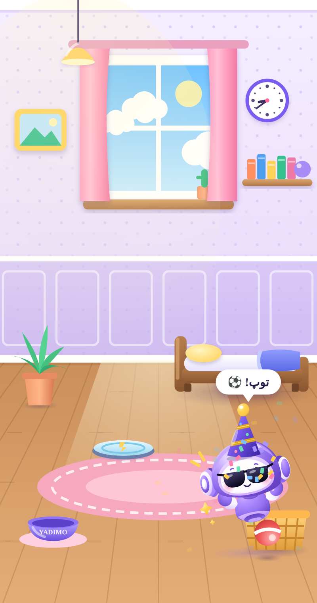
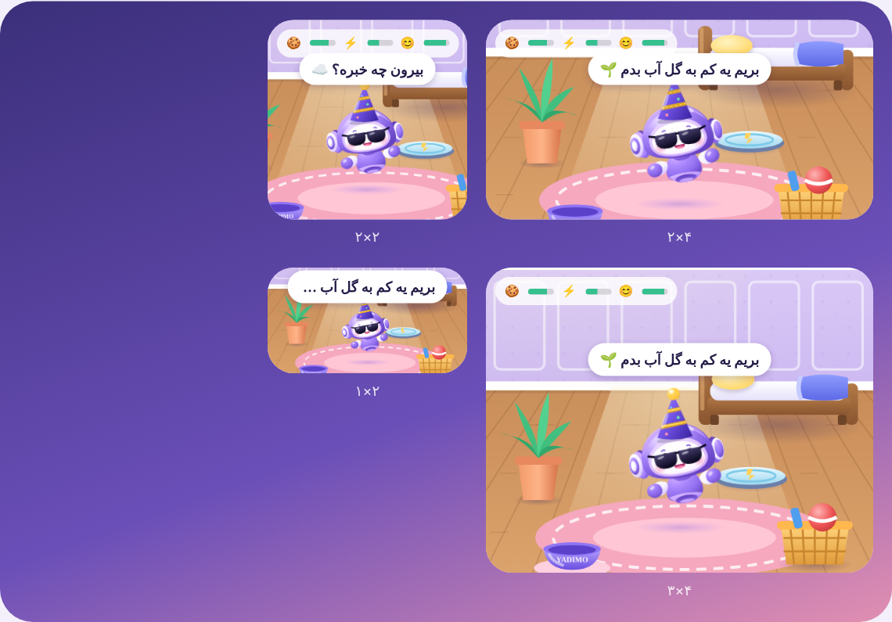

# یادیمو | Yadimo

**یادآور و یادداشت فارسی با یک دوست زنده به اسم یادیمو**

قرص، قسط، تولد، جلسه، خرید… فقط بگو یا بنویس؛ یادیمو سر وقت یادت می‌آورد.

 

<table>
<tr>
<td width="50%" align="center"> <b>خانهٔ یادیمو</b>: غذا بده، توپ‌بازی کن، بخوابانش</td>
<td width="50%" align="center"> <b>ویجت</b>: تماشا کن یادیمو چه می‌کند</td>
</tr>
</table>

## چه کارهایی می‌کند

| | |
|---|---|
| 🎙️ **دستیار هوشمند** | عادی حرف بزن یا بنویس: «هر شب ساعت ۱۰ قرص، با زنگ»، «جلسهٔ فردا رو ببر ساعت ۱۱»، «هفتهٔ بعد چی دارم؟». یادآوری و یادداشت می‌سازد، عوض می‌کند و جواب می‌دهد. |
| ⏰ **یادآوری مطمئن** | اعلان دقیق یا زنگ تمام‌صفحه حتی روی صفحهٔ قفل، تعویق، یادآوری زودتر، تکرار هشدار تا انجام، و بازیابی بعد از ری‌استارت. |
| 🔁 **هر نوع تکرار** | هر چند ساعت، روزانه، روزهای خاص هفته، ماهانه (روز مشخص یا آخر ماه)، سالانه، «N روز پس از انجام»، با تقویم شمسی یا میلادی. |
| 🗒️ **یادداشت و لیست** | رنگ، سنجاق، چک‌لیست و ویجت یادداشت. |
| 🐣 **یادیمو** | دوست زندهٔ برنامه: صفحهٔ خانه را می‌گردد و حرف می‌زند، سلام صبح با برنامهٔ روز می‌دهد، لباس و لوازم دارد و خانهٔ خودش را دارد که در آن غذا می‌خورد، بازی می‌کند و می‌خوابد. |
| 🏆 **سطح و مأموریت** | با هر کار انجام‌شده امتیاز بگیر، سطحت را بالا ببر، نشان جمع کن و با مأموریت‌ها توکن هدیه بگیر. |
| 📊 **آمار** | چقدر از کارهایت را انجام داده‌ای و کدام‌ها جا می‌مانند. |
| ☁️ **همگام‌سازی ابری** (اختیاری) | نسخهٔ رمزنگاری‌شده روی سرور؛ با عوض شدن گوشی، با ورود به حساب همه‌چیز برمی‌گردد. |
| 👥 **گروه‌ها** (آزمایشی) | یادآوری مشترک با خانواده و دوستان: برای همه یا یک نفر، «یک نفر کافیه» یا «همه باید انجام بدن». |
| 📱 **ویجت‌ها** | ثبت سریع، امروز، هفته، نزدیک‌ترین یادآوری، یادداشت و خانهٔ یادیمو. |
| 🌙 **فارسی و انگلیسی** | راست‌به‌چپ کامل، فونت وزیرمتن، چند تم و حالت تیره. |

بدون حساب هم همه‌چیز کار می‌کند و اطلاعات فقط روی گوشی خودت است. حساب (با کافه‌بازار یا شماره) برای دستیار هوشمند، همگام‌سازی ابری و گروه‌ها لازم است.

## نصب نسخهٔ آزمایشی

1. از بخش [Releases](https://github.com/maboox/yadarapp/releases) فایل `Yadimo-bazaar-xxxxxxx.apk` را بگیر و نصب کن.
2. نسخه‌های بعدی را روی همین نصب کن تا اطلاعات بماند.
3. بعد از نصب به «پروفایل ← ⚙️ تنظیمات ← سلامت اعلان‌ها» برو و همه را سبز کن. در شیائومی، سامسونگ و هواوی «اجرای خودکار» را روشن و محدودیت باتری را بردار.

## برای توسعه‌دهنده‌ها

- **برنامه:** Kotlin و Jetpack Compose در `app/`. یادیمو و بازی خانه‌اش با SVG و JavaScript در `docs/yadimo/` نوشته شده‌اند و `tools/sync-yadimo.sh` آن‌ها را به `app/src/main/assets/yadimo/` کپی می‌کند.
- **سرور:** Go و PocketBase در `server/` (حساب، توکن، دستیار هوشمند، همگام‌سازی ابری و گروه‌ها). راهنمای راه‌اندازی در `server/README.md` است.
- **ساخت:** با هر Push، GitHub Actions تست‌ها را اجرا می‌کند و APK و بستهٔ سرور را در Releases می‌گذارد.
- **یادداشت‌های ادامهٔ کار:** `docs/HANDOFF.md`.

---

**Yadimo** is a Persian/English reminder and notes app for Android with a living mascot. Speak or type naturally and it creates and changes reminders; alerts are exact (or full-screen alarms) with any repeat rule in the Persian or Gregorian calendar. Optional encrypted cloud sync, shared group reminders, levels and missions, and home-screen widgets, including one where you watch Yadimo live its day. The app is Kotlin/Compose; the server is Go/PocketBase.

